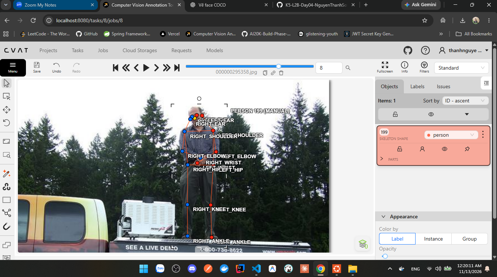
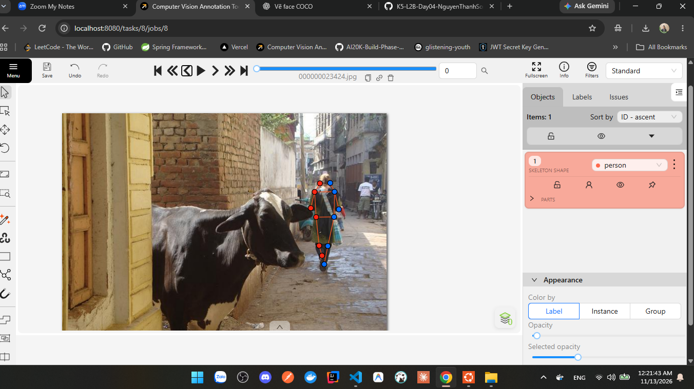
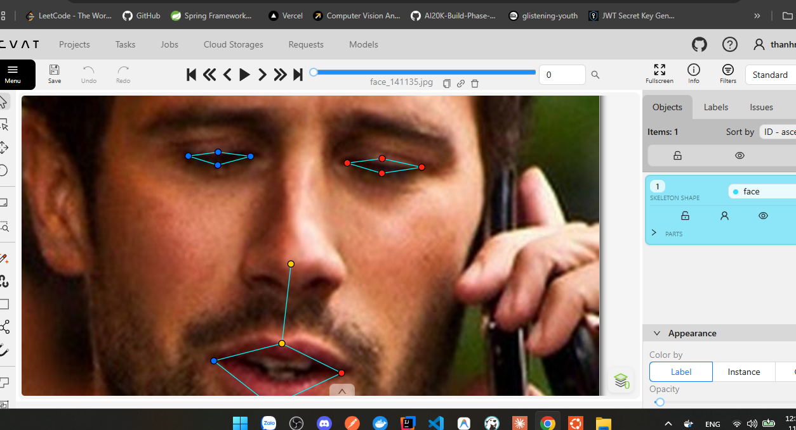
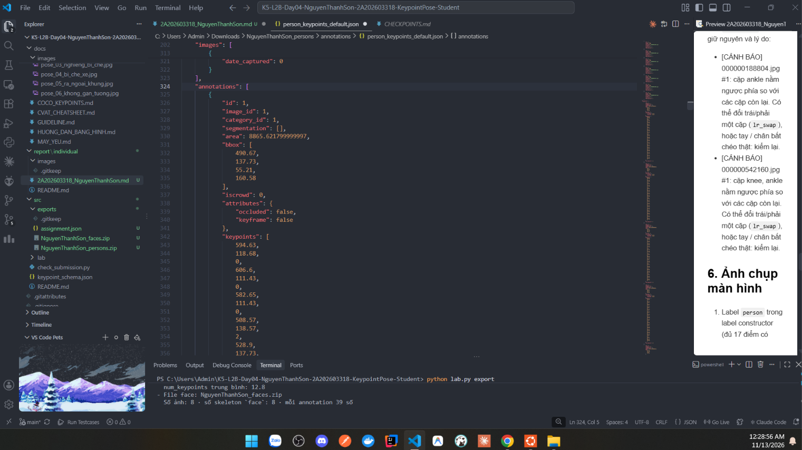

# Báo cáo cá nhân — HoVaTen-MSSV


Dữ liệu: 12 ảnh người COCO val2017 (Lin et al., 2014) và 8 ảnh chân dung Wikimedia Commons, chỉ dùng trong lớp.

## 0. Thông tin học viên

- Họ tên: Nguyễn Thanh Sơn 
- MSSV: 2A202603318
- Email: thanhnguyensonjqk@gmail.com
- Link repository: https://github.com/ThanhSon2903/K5-L2B-Day04-NguyenThanhSon-2A202603318-KeypointPose-Student
- Phiên bản CVAT (Help → About): 
- Máy: hệ điều hành Window · RAM 20 GB · chạy CVAT chế độ đầy đủ
- Bộ ảnh (`src/exports/assignment.json` do `lab.py setup` tạo): có 
- Giờ bắt đầu: 20h
- Giờ kết thúc: 23h
## 1. Kiểm tra label (CP0)

| Label | Kiểu | Số điểm | Tên điểm đúng bảng của lab? | Đúng thứ tự? | Số cạnh |
|---|---|---:|---|---|---:|
| `person` |Skeleton | 17 | Có |Có |Theo cấu hình |
| `face` |Skeleton |13 |Có |Có |Theo cấu hình |

- `person`: 17 keypoints theo COCO Human Pose.
- `face`: 13 keypoints theo riêng của Lab.

Mẫu `person` dựng theo người quay mặt về camera (các điểm `left_*` nằm bên phải khung mẫu)? Có / Không
- Mẫu `person` dựng theo người quay mặt về camera, các điểm left_* nằm bên phải khung mẫu

Cách đổi cờ `occluded` / `outside` cho **một điểm** trên phiên bản CVAT này (một câu):
- Ví dụ: Chọn skeleton, chọn keypoint cần chỉnh, sau đó thay đổi thuộc tính Occluded hoặc Outside trong bảng thuộc tính của điểm (tùy phiên bản CVAT).

...

## 2. Số lượng đã gán và thời gian (CP1, CP2)

| Nhóm ảnh | Số ảnh | Số skeleton đã gán | Số người dưới 60 px (không gán) | Số poster / gương / màn hình bỏ qua | Thời gian (phút) |
|---|---:|---:|---:|---:|---:|
| `easy` | 5 | 9| 0 | 0|30 |
| `occluded` | 4 |0 | 0| 0|70 |
| `back` | 2 | 2|1|0 |40 |
| `small` | 1 |0 |0 |0 |0 |
| `crowd` | 1 |0 | 0|0 |0 |
| `faces` | 8 |8 | 0 | 0| 30|

Kết quả tổng quan:

- Số ảnh người đã hoàn thành: 12/12 ảnh.

- Tổng số skeleton người: 18.

- Tổng số skeleton khuôn mặt: 8.

- Tổng số annotation đã thực hiện: 26 skeleton.
- Số ảnh người đã xong ở mốc phút 105: 7 / 10
- Thời gian thực tế (phút): CP1 20 · CP2 30 · CP3 30
- Ảnh tốn thời gian nhất là ảnh bên phía persons.zip và cụ thể là bức ảnh 3 người đánh bóng chày vì cần phải nhìn rõ hướng người đứng vì những người đó họ đứng chồng lên nhau nên rất khó xác định


## 3. Bảng ca khó (CP1, CP2)

Mỗi điểm bạn phân vân một dòng, nhất là phân vân giữa `v = 1` và `v = 0`, hoặc không chắc hướng người.

| Ảnh | Người / mặt | Điểm | Cờ đã chọn | Phân vân giữa | Lý do chọn |
|---|---|---|---:|---|---|
|000000188804 |Người quay tư thế phức tạp |Ankle trái/phải |v = 2 |Đảo trái/phải hoặc tư thế chân bắt chéo Chân trái vắt ra phía sau chân phải nên vị trí hai mắt cá chân có thể trông ngược so với thông thường. Tôi kiểm tra lại tư thế và giữ nguyên nhãn. |Chân trái vắt ra phía sau chân phải nên vị trí hai mắt cá chân có thể trông ngược so với thông thường. Tôi kiểm tra lại tư thế và giữ nguyên nhãn.
|000000542160 |Người trong tư thế bắt chéo |Knee, ankle |v = 2 | Đảo trái/phải hoặc tư thế chân bắt chéo |Các cặp đầu gối và mắt cá chân có vị trí khác thường. Sau khi kiểm tra lại, tôi nhận thấy tư thế chân có thể giải thích được vị trí này nên chưa thay đổi nhãn. |
|Ảnh người bị che khuất |Người |Các khớp bị che |v=1 hoặc v=0 |Điểm bị che nhưng ước lượng được hoặc không xác định được vị trí |Tôi dựa vào khả năng xác định vị trí khớp từ tư thế cơ thể. Nếu vẫn xác định được vị trí thì chọn v=1, nếu không xác định được thì chọn v=0 theo guideline. |

## 4. Bảng tự review (CP3)

- Quá trình review:

Sau khi hoàn thành annotation, tôi kiểm tra lại các ảnh theo thứ tự từ ảnh cuối về ảnh đầu. Tôi tập trung vào các lỗi có thể xảy ra như đảo trái/phải, đặt keypoint sai vị trí, chọn sai visibility, thiếu hoặc thừa keypoint. Đặc biệt, tôi chú ý các ảnh người quay lưng và có tư thế tay chân bắt chéo.

Đi từ ảnh cuối về ảnh đầu. 5 ảnh người (ít nhất 2 ảnh `back` hoặc `crowd`) và 3 ảnh mặt. Ít nhất 8 dòng, kể cả dòng `ok`. Ghi lỗi trước, sửa sau.

Mã lỗi dùng đúng một trong: `lr_swap`, `vis_flag`, `position`, `missing`, `extra`, `ok`.

| Ảnh | Người / mặt | Điểm | Mã lỗi | Ghi chú | Đã sửa? |
|---|---|---|---|---|---|
|000000188804 |Người |Ankle |lr_swap |Kiểm tra cặp mắt cá chân, ban đầu nghi ngờ nhầm trái/phải do tư thế chân bắt chéo. Sau khi xem lại ảnh, xác nhận vị trí phù hợp. |Không |
|000000542160 |Người |Knee, ankle |lr_swap |Hai cặp khớp chân có vị trí bất thường, kiểm tra lại theo hướng cơ thể và giữ nguyên. |Không |


Tổng hợp số lỗi theo mã:

| `lr_swap` | `vis_flag` | `position` | `missing` | `extra` | `ok` |
|---:|---:|---:|---:|---:|---:|
|2|0|0|0|0 | 0|

Điểm còn phân vân giữa `v = 1` và `v = 0` (ghi cả hai lựa chọn và lý do chọn): Không có điểm nào cả

## 5. Kiểm file xuất và kết quả tự kiểm (CP4)

Tự kiểm tay trong file JSON:

| File | Người / mặt kiểm (ảnh, thứ tự) | Số phần tử `keypoints` | Điểm `outside` ra `v = 0`, `occluded` ra `v = 1`? | `num_keypoints` khớp? |
|`NguyenThanhSon_persons.zip`|`000000023424` - annotation người thứ nhất|51 giá trị|Có 75 điểm v=0, cần kiểm tra thủ công cờ từng điểm|Khớp theo kết quả tự kiểm|
| `NguyenThanhSon_faces.zip` |`face_141135` – annotation mặt thứ 1 |39 giá trị | Có 8 điểm v=0, cần kiểm tra thủ công cờ từng điểm|Khớp theo kết quả tự kiểm|

Sau khi xuất, CVAT ghi `occluded` thành `v = 1` và `outside` thành `v = 0`. Có 83 diểm v = 0 vẫn giữ toạ độ cũ, thay vì chuyển về (0,0)

Hai job đã chuyển sang completed trên CVAT: Có

[OK] src\exports\NguyenThanhSon_persons.zip
[OK] src\exports\NguyenThanhSon_faces.zip

=== ...NguyenThanhSon_persons.zip (label `person`) ===
  [CẢNH BÁO] 000000188804.jpg #1: cặp ankle nằm ngược phía so với các cặp còn lại. Có thể đổi trái/phải một cặp (`lr_swap`), hoặc tay / chân bắt chéo thật: kiểm lại.
  [CẢNH BÁO] 000000542160.jpg #1: cặp knee, ankle nằm ngược phía so với các cặp còn lại. Có thể đổi trái/phải một cặp (`lr_swap`), hoặc tay / chân bắt chéo thật: kiểm lại.

=== ...NguyenThanhSon_faces.zip (label `face`) ===

----- TÓM TẮT -----
- File person: NguyenThanhSon_persons.zip
  Số ảnh: 12 · số skeleton `person`: 18 · mỗi annotation 51 số
  Skeleton theo ảnh:
  000000023424=1, 000000078170=2, 000000100510=1,
  000000150500=1, 000000156986=2, 000000162046=1,
  000000188804=2, 000000194027=1, 000000295358=1,
  000000493741=1, 000000518966=2, 000000542160=3
  Cờ v: v=2 208 (68%) · v=1 23 (8%) · v=0 75 (25%)
  num_keypoints trung bình: 12.8

- File face: NguyenThanhSon_faces.zip
  Số ảnh: 8 · số skeleton `face`: 8 · mỗi annotation 39 số
  Skeleton theo ảnh:
  face_141135=1, face_147624=1, face_436791=1,
  face_514826=1, face_560282=1, face_79591=1,
  face_92028=1, face_99874=1
  Cờ v: v=2 95 (91%) · v=1 1 (1%) · v=0 8 (8%)
  num_keypoints trung bình: 12.0

- Ghi chú: 83 điểm v = 0 vẫn mang tọa độ cũ (CVAT 2.x xuất như vậy; chuẩn COCO ghi 0, 0). Không phải lỗi: điểm v = 0 bị bỏ qua khi huấn luyện và khi chấm.

- Số [LỖI]: 0 · số [CẢNH BÁO]: 2
Kết quả: ĐẠT (đọc lại từng cảnh báo ở trên)

Các `[CẢNH BÁO]` còn giữ nguyên và lý do:

- [CẢNH BÁO] 000000188804.jpg #1: cặp ankle nằm ngược phía so với các cặp còn lại. Có thể đổi trái/phải một cặp (`lr_swap`), hoặc tay / chân bắt chéo thật: kiểm lại.
=> Lý do: Chân trái vắt treo phía sau chân phải và đã kiểm tra lại và không phát hiện đặt nhầm key-point
- [CẢNH BÁO] 000000542160.jpg #1: cặp knee, ankle nằm ngược phía so với các cặp còn lại. Có thể đổi trái/phải một cặp (`lr_swap`), hoặc tay / chân bắt chéo thật: kiểm lại.
=>Vẫn giữ lại với lý do như bên trên

## 6. Ảnh chụp màn hình

1. Label `person` trong label constructor (đủ 17 điểm có tên):

   

2. Một người quay lưng đã gán, cờ đã đặt:

   

3. Một khuôn mặt đã gán 13 điểm, phóng to vùng mắt:

   

4. Một đoạn JSON xuất của một người:

   
## 7. Tự đánh giá

1. Lỗi bạn mắc nhiều nhất hôm nay, và cách bạn sẽ tránh ở dự án thật:
- Khó khăn lớn nhất là xác định chính xác trái/phải của các khớp khi người quay lưng, đứng nghiêng hoặc có tư thế bắt chéo tay chân. Nếu chỉ dựa vào vị trí trên khung hình, rất dễ gán nhầm left và right.

- Để hạn chế lỗi trong dự án thực tế, cần xác định hướng cơ thể trước khi đặt keypoint, kiểm tra tính nhất quán giữa các cặp khớp vai, khuỷu tay, cổ tay, hông, đầu gối và mắt cá chân. Sau khi gán xong nên review lại các ảnh khó thay vì chỉ kiểm tra số lượng keypoint.

2. Một quy tắc bạn đề xuất thêm vào guideline (kèm ảnh ví dụ nếu có):

- Nên bổ sung ví dụ minh họa riêng cho trường hợp người quay lưng, người đứng nghiêng và người có tay/chân bắt chéo. Trong các ví dụ đó cần phân biệt rõ trái/phải theo giải phẫu của đối tượng, không theo góc nhìn của người annotate. Đồng thời nên có ví dụ về trường hợp keypoint bị che khuất nhưng vẫn có thể ước lượng vị trí và trường hợp hoàn toàn không xác định được vị trí.

3. Nhãn của bạn đi vào model ở đâu? Chọn một lỗi bạn đã sửa và nói nó sẽ làm model học sai thế nào (heatmap, trọng số trong loss, hay bước lật ảnh):

- Keypoint annotation được sử dụng làm ground truth để huấn luyện mô hình Human Pose Estimation. Mô hình học cách dự đoán vị trí các khớp thông qua heatmap hoặc tọa độ keypoint, đồng thời sử dụng visibility để xác định những điểm nào cần tham gia tính loss.

- Nếu gán nhầm trái/phải giữa hai khớp, mô hình có thể học sai vị trí của keypoint tương ứng. Đặc biệt, khi dữ liệu được augmentation bằng cách lật ảnh ngang, việc xử lý không đúng cặp trái/phải có thể khiến nhãn không nhất quán và làm giảm chất lượng dự đoán.

## 8. Khó khăn và lỗi kỹ thuật

-Trong quá trình thực hiện, việc đặt keypoint chính xác trên các ảnh có người quay lưng, bị che khuất hoặc có tư thế phức tạp mất nhiều thời gian hơn so với ảnh chính diện.

- Ngoài ra, cần phân biệt rõ ba trạng thái visibility: điểm nhìn thấy được, điểm bị che khuất nhưng vẫn xác định được vị trí và điểm không nhìn thấy/không xác định được theo quy định của Lab.

- Sau khi hoàn thành annotation, đã xuất dữ liệu từ CVAT và chạy src/check_submission.py. Hai file ZIP đều được kiểm tra hợp lệ, không có lỗi cấu trúc; tuy nhiên còn hai cảnh báo cần review thủ công về khả năng đảo trái/phải ở các khớp chân.

## Bonus (nếu làm)

### B1 — 3 ảnh người khó thêm

| Ảnh | Số skeleton | Số người dưới 60 px | Ca khó nhất |
|---|---:|---:|---|
| | | | |
| | | | |
| | | | |

Kết quả `src/check_submission.py` cho `HoVaTen_bonus_persons.zip`:

```text
(dán ở đây)
```

### B2 — 5 ảnh khuôn mặt đen trắng / hồng ngoại

Ảnh không màu khó hơn ở điểm nào? Kính râm trên ảnh hồng ngoại có còn là `v = 1` không?

...

### B3 — Model so với nhãn của tôi (không tính điểm)

- Demo đã dùng:
- Ảnh đã thử:

1. Model có trả điểm cho khớp bị che, hay khớp ngoài ảnh không? Confidence ở các điểm đó thế nào?

   ...

2. Với người quay lưng, model có đổi trái/phải không?

   ...

3. Bộ điểm của model có giống 17 điểm COCO không?

   ...

## 9. Tài liệu tham khảo và công cụ AI đã dùng

- Tài liệu tham khảo:

   COCO: Common Objects in Context — Lin et al. (2014).

   COCO Human Pose Keypoints.

   Wikimedia Commons — nguồn ảnh chân dung sử dụng trong bài thực hành.

   Guideline và tài liệu hướng dẫn của Lab về Keypoint Pose.

   Tài liệu hướng dẫn CVAT.
- Công cụ sử dụng:

   CVAT: tạo skeleton và gán nhãn keypoint.

   Python: chạy script kiểm tra cấu trúc và kết quả annotation.

   Git và GitHub: quản lý mã nguồn, lưu trữ bài thực hành.

   ChatGPT: hỗ trợ giải thích guideline, phân biệt visibility, hướng dẫn thao tác CVAT và hỗ trợ diễn giải kết quả kiểm tra. Nội dung annotation được thực hiện và kiểm tra bởi học viên.